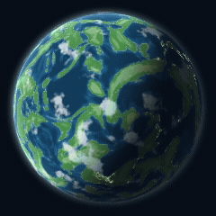
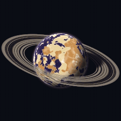
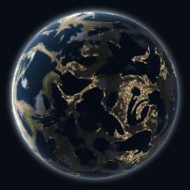

# planet

A procedural planet on a canvas: noise-generated terrain, clouds, atmosphere, city lights and rings, lit and spinning. No dependencies, browser or Node.

<p>
  
  
  
</p>

```
npm install @shieldsbetter/planet
```

```html
<div id="world" style="width: 320px; height: 320px"></div>
<script type="module">
    import Planet from '@shieldsbetter/planet';
    const planet = Planet.mount('#world', { seed: 404, rings: true });
</script>
```

`mount` fills the element with a transparent canvas, keeps it sized, and starts spinning. The planet it returns has `set(options)`, `stop()`, `start()`, `exportFrame(t)` (PNG bytes) and `destroy()`. `Planet.offscreen(w, h, options)` renders without a DOM, under Node too. `compile()` bakes a planet to JSON that `Planet.from(target, json)` shows instantly. `index.html` in the repo is a demo page with controls for every option.

## Options

| Option                         | Default                   |                                                                        |
| ------------------------------ | ------------------------- | ---------------------------------------------------------------------- |
| `seed`                         | `1`                       | Same seed, same planet.                                                |
| `terrain`                      | `'continents'`            | Also `'ridged'`, `'plates'`, `'archipelago'`, `'pangaea'`.             |
| `seaLevel`                     | `0.62`                    | Fraction of the surface under water.                                   |
| `continentScale`               | `1.55`                    | Higher: more, smaller landmasses.                                      |
| `plateCount`                   | `22`                      | `'plates'` only.                                                       |
| `warp`                         | `0.30`                    | Domain warp; `0` gives blobbier continents.                            |
| `oceanColor` / `landColor`     | `'#1d5e86'` / `'#4a8f4a'` |                                                                        |
| `landColorB`                   | `'#a8994f'`               | A second biome.                                                        |
| `biomeSplit`                   | `0`                       | Fraction of the land that's `landColorB`.                              |
| `biomeScale`                   | `1.15`                    | Lower: fewer, broader biomes.                                          |
| `cloudAmount`                  | `0.42`                    | `0` for no clouds.                                                     |
| `cloudOpacity`                 | `0.75`                    |                                                                        |
| `cloudScale`                   | `2.1`                     | Higher: smaller, busier clouds.                                        |
| `cloudRadius`                  | `1.025`                   | Cloud shell size, in planet radii.                                     |
| `cloudColor`                   | `'#ffffff'`               |                                                                        |
| `atmosphereColor`              | `null`                    | `null`: a pale version of the ocean.                                   |
| `glowSize` / `glowStrength`    | `0.12` / `0.70`           | The halo.                                                              |
| `rimStrength`                  | `0.75`                    | Brightening at the edge.                                               |
| `ambient`                      | `0.16`                    | How dark the night side gets.                                          |
| `sunAzimuth`                   | `37.376`                  | Degrees: `0` sun behind you, `180` behind the planet.                  |
| `sunElevation`                 | `24.870`                  | Degrees.                                                               |
| `lightDir`                     | `null`                    | An `[x, y, z]` to use instead of the two angles.                       |
| `axialTilt` / `axialRoll`      | `0` / `0`                 | Degrees.                                                               |
| `civilization`                 | `0`                       | 0–1: city lights on the night side.                                    |
| `cityColor` / `cityBrightness` | `'#ffcf8a'` / `0.95`      |                                                                        |
| `cityClusters`                 | `24`                      |                                                                        |
| `rings`                        | `false`                   | Turns on the ring options below.                                       |
| `ringColor`                    | `'#cbbfa8'`               |                                                                        |
| `ringInner` / `ringOuter`      | `1.35` / `2.25`           | In planet radii.                                                       |
| `ringOpacity`                  | `0.85`                    |                                                                        |
| `ringTilt` / `ringRoll`        | `18` / `-14`              | Degrees.                                                               |
| `ringBands`                    | `9`                       | Higher: finer bands.                                                   |
| `ringShadow`                   | `0.60`                    | `0` for none.                                                          |
| `spin` / `cloudSpin`           | `0.02` / `0.027`          | Rotations per second.                                                  |
| `textureWidth`                 | `768`                     | Terrain texture size.                                                  |
| `maxResolution`                | `400`                     | Render size cap, in pixels.                                            |
| `renderer`                     | `'webgl'`                 | Or `'software'`; WebGL falls back to software when it isn't available. |
| `autoStart`                    | `true`                    | `mount` only: `false` draws one frame and waits.                       |

## License

ISC
